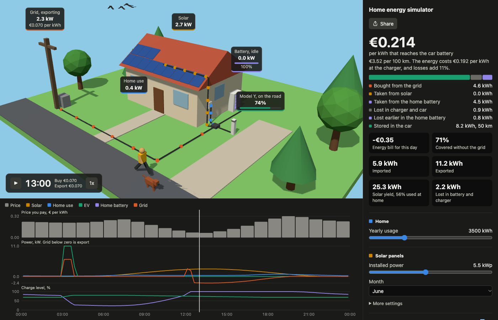

# Home energy simulator

What does charging an EV cost per kWh when you have solar panels, a home battery and a dynamic energy contract? This simulator plays one day in 15-minute steps and shows the answer in a 3D scene of a house, with a chart and totals next to it.

Try it at [pbrdebruijn.github.io/web-energy-sim](https://pbrdebruijn.github.io/web-energy-sim/).



## What it does

- Plays a day of solar output, house use, battery and EV charging against hourly day-ahead prices. It loads today's live prices from EnergyZero, or uses a sample winter or summer day.
- Prices follow the Zonneplan dynamic tariff: day-ahead price plus 21% VAT, a €0.02 purchase fee and €0.1108 energy tax per kWh. Saldering, net metering that ends on 1 January 2027, can be switched on or off.
- The home battery either trades on price or stores solar surplus only. The car charges in the cheapest hours of its slot, as soon as it plugs in, or from solar surplus only.
- The result is the price per kWh that actually reaches the car battery, after charger, car and battery losses.
- Click a label in the scene to change that device's settings. The sidebar has every setting, with the detailed ones under **More settings**.
- **Share** gives a link that opens the simulator with the same settings. The link holds only what differs from the defaults, like `#month=7&batt.kwh=17`.
- The scenery follows the month: snow, blossom, birds, falling leaves, a snowman and a pumpkin.
- It works on phones. The chart and the settings open from buttons on the scene.

## Home Assistant card

The same 3D scene is available as a dashboard card for Home Assistant, fed by your real sensors instead of the simulation. Install it through HACS. The [card README](https://github.com/pbrdebruijn/web-energy-sim/blob/main/README.md) has the instructions, and HACS shows that same page.

## Run it locally

The website needs no build step. Serve the folder and open it:

```sh
npm start        # python3 -m http.server 5173
npm test         # simulator and card data tests
```

The card needs a build, because Home Assistant cannot load Three.js from a CDN through an import map:

```sh
npm install
npm run build    # writes dist/energy-scene-card.js
```

Open `card-demo.html` to try the built card against fake Home Assistant states that come from the simulator. Add `?light` for a light theme.

## Files

| File | What it holds |
|---|---|
| `index.html`, `main.js` | The website: settings, results, sharing, playback |
| `sim.js` | The simulation of one day, and the price samples |
| `scene.js`, `season.js` | The 3D scene and its seasonal scenery |
| `ui.js` | Labels, chart and their styles, used by the website and the card |
| `card.js`, `ha-data.js` | The Home Assistant card and its data handling |
| `dist/energy-scene-card.js` | The built card that HACS installs |
| `README.md`, `hacs.json` | What HACS shows and installs |
