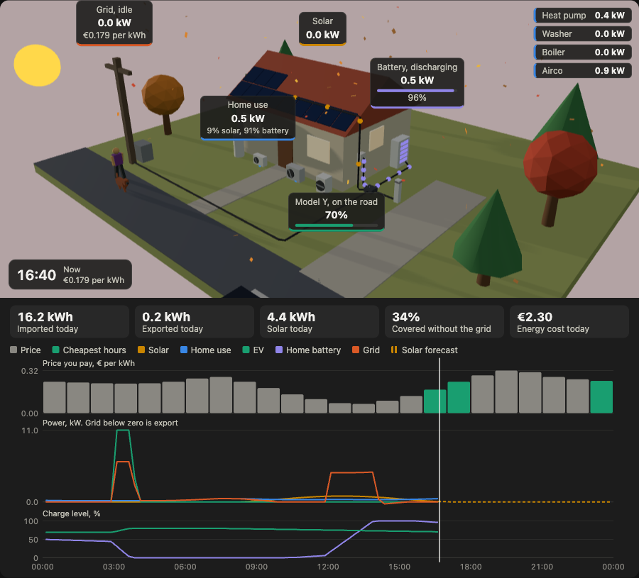

# Energy scene card

A Home Assistant dashboard card that draws your home as a small 3D scene. Power flows along the cables as moving dots: solar from the roof, the grid at the pole, the home battery by the wall and the car at the charger. Below the scene, a chart shows today so far: price, power per device and charge levels.



What the card does:

- Each dot takes the colour of where its power comes from: yellow for solar, purple for the home battery, orange for the grid. A car charging on solar gets yellow dots, and the car and house labels say it in numbers, like "70% solar, 30% grid".
- Labels follow each device and show its power right now. Click a label to open that entity's details and history in Home Assistant.
- The sun moves with the real time and month, the windows light up at night, and the panels glow with the solar output.
- The scenery follows the season. Snow and a snowman in winter, blossom in spring, birds in summer, falling leaves in autumn and a pumpkin in October. A jogger and a dog run past by day.
- The car drives off when it is unplugged and parks again when it comes back, if you add a plugged-in sensor.
- A row of tiles shows today's totals from the Energy dashboard: imported, exported, solar, the share of your use covered without the grid, and today's energy cost when the Energy dashboard tracks it. They are the same meter readings the Energy dashboard uses, refreshed every 5 minutes.
- The chart marks the cheapest hours still to come in green and negative prices in blue, and continues the solar line as a dashed forecast when the Energy dashboard has a solar forecast, such as Forecast.Solar.
- Drag across the chart to replay earlier today in the scene. After 15 seconds the card returns to now.
- The card only animates while it is on screen, so a wall tablet does not spend its battery on a hidden card.

You don't need every device. Leave out the battery or the car and the card shows them as off.

## Install

### With HACS

1. Open HACS in Home Assistant.
2. Open the menu at the top right and choose **Custom repositories**.
3. Add `https://github.com/pbrdebruijn/web-energy-sim` with type **Dashboard**.
4. Search for **Energy scene card**, open it and choose **Download**.
5. Reload your browser.

HACS adds the dashboard resource for you.

### By hand

1. Download `energy-scene-card.js` from the [dist folder](https://github.com/pbrdebruijn/web-energy-sim/tree/main/dist).
2. Copy it to `/config/www/` on your Home Assistant machine.
3. Go to **Settings → Dashboards**, open the menu at the top right and choose **Resources**.
4. Add `/local/energy-scene-card.js` as a **JavaScript module**.
5. Reload your browser.

## Add the card

Edit a dashboard, choose **Add card** and pick **Energy scene**.

If you added power sensors to the **Energy dashboard** (Settings → Dashboards → Energy), the card uses those for grid, solar, home battery and house use. It also follows later changes there. For everything else, like the car, price and weather, the card looks through your sensors and fills in a first guess. Check each pick in the editor and change the ones that are wrong. Every field has a short note on what the card expects.

If a flow runs the wrong way in the preview, pick that sensor under **Reverse the sign of**.

### In YAML

You can also add a **Manual** card and paste this, with your own entity ids:

```yaml
type: custom:energy-scene-card
ev_name: Model Y
entities:
  grid: sensor.grid_power
  solar: sensor.solar_power
  battery: sensor.battery_power
  battery_soc: sensor.battery_level
  ev: sensor.wallbox_power
  ev_soc: sensor.car_battery_level
  ev_plugged: binary_sensor.car_plugged_in
  price: sensor.electricity_price
  weather: weather.home
invert:
  - battery
```

Every sensor is optional. Sensors you leave out come from the Energy dashboard when it has them, so `type: custom:energy-scene-card` on its own works for a home with power sensors set up there. Without the Energy dashboard, add at least `grid`.

## Options

| Option | Default | What it does |
|---|---|---|
| `entities` | | The sensors to show. See the table below. |
| `invert` | none | Power entities whose sign is the other way around from what the card expects, for example `[battery]`. |
| `height` | `420` | Height of the 3D scene in pixels. |
| `chart` | `true` | Set to `false` to hide the chart of today. |
| `cheapest_hours` | `3` | How many of the cheapest hours still to come the chart marks. `0` turns it off. |
| `totals` | `true` | Set to `false` to hide today's totals. They only show when the Energy dashboard has energy meters. |
| `solar_kwp` | `5.5` | Your solar peak power in kWp. The scene shows one panel per 0.45 kWp, and the panels glow by output against this number. |
| `ev_name` | `EV` | Name on the car's label. |
| `devices` | from the Energy dashboard | Extra devices to show, see below. |

### Devices

Show up to 4 extra devices, like a heat pump or a washing machine. Each gets a small model along the front of the house that spins and lights up while it uses power, and a line in the top right corner with its power. Click that line for its details and history.

```yaml
devices:
  - entity: sensor.heat_pump_power
    type: heat_pump
    name: Heat pump
  - entity: sensor.washing_machine_power
    type: washing_machine
```

`type` is one of `heat_pump`, `ac`, `boiler`, `washing_machine` or `other`, and `name` is optional. Without a `devices` list, the card shows the individual devices from the Energy dashboard that have a power sensor. Devices show their power right now. They are part of the house use, so the chart does not draw them separately.

### Entities

The card reads power in W or kW, and converts using each sensor's unit.

| Key | Entity | Sign the card expects |
|---|---|---|
| `grid` | Grid power | Positive when importing, negative when exporting |
| `solar` | Solar power | Positive when producing |
| `battery` | Home battery power | Positive when discharging into the house, negative when charging |
| `battery_soc` | Home battery level in % | |
| `ev` | Charger power | Positive when charging the car |
| `ev_soc` | Car battery level in % | |
| `ev_plugged` | `binary_sensor` that is `on` when the car is plugged in, or a `device_tracker` that is `home` | |
| `home` | House consumption | Positive. Leave it out and the card works it out as solar + grid + battery minus EV. |
| `price` | Current electricity price in € or ct per kWh | |
| `weather` | A `weather` entity, for clouds and sunshine in the scene | |

Integrations disagree about signs. Many batteries report charging as positive. If a flow runs the wrong way in the scene, add that key to `invert`.

### Prices

The chart shows the price per hour when your price sensor has a `today` attribute with 24 hourly or 96 quarter-hour prices, as Nord Pool sensors do. Other sensors still work. The card then shows the prices recorded so far today.

## How it gets the data

The card reads the current state of each entity, and loads today's history once on start and again every 5 minutes through Home Assistant's `history/history_during_period` call. It averages the history per 15 minutes. Everything stays inside Home Assistant. The card makes no calls to other services.

## Troubleshooting

- **"Entity not found" under the scene.** An entity id in the config does not exist. Check the spelling in **Developer tools → States**.
- **A flow runs the wrong way.** Add the key to `invert`.
- **The chart is empty before now.** The entity has no recorded history today, for example because the recorder excludes it.
- **The card stays blank.** Reload the browser after installing, so it loads the new resource. The card needs WebGL, which every current browser has.

## The simulator

This card shares its 3D scene with a home energy simulator that runs in the browser. It shows what a battery and smart EV charging would do with dynamic Dutch prices: [pbrdebruijn.github.io/web-energy-sim](https://pbrdebruijn.github.io/web-energy-sim/).
